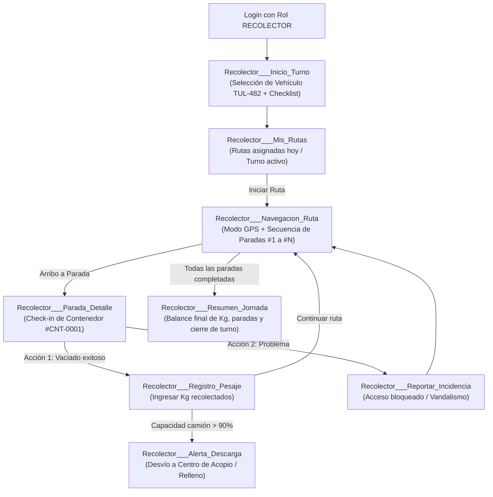

# Especificación de Vistas, Flujos de Usuario y Brechas de Diseño — EcoRuta

Este documento consolida el análisis de diseño de la aplicación **EcoRuta**, estableciendo el flujo interactivo de pantallas, las directrices del sistema de diseño y la especificación detallada de las vistas existentes y **faltantes**, divididas formalmente entre los dos tipos de usuarios operativos de la plataforma: **Ciudadano** y **Recolector**.

---

## 1. Diagnóstico del Estado Actual

A partir de la inspección de las 27 capturas en alta fidelidad ubicadas en [`docs/design/screens/`](file:///C:/Projects/Eco_Ruta-deska/docs/design/screens/), se determinó que:
- **100% de los diseños actuales pertenecen al rol `CIUDADANO`**.
- El sistema cuenta contractualmente (ver [`modelo_de_datos.md`](file:///C:/Projects/Eco_Ruta-deska/docs/modelo_de_datos.md) y [`contratos_api.md`](file:///C:/Projects/Eco_Ruta-deska/docs/contratos_api.md)) con **dos perfiles operativos de usuario**:
  1. **Ciudadano**: Consulta horarios, ubica contenedores, aprende a separar y emite reportes de anomalías.
  2. **Recolector (Conductor/Operario)**: Ejecuta las rutas asignadas, realiza el check-in en cada punto de recolección y actualiza la capacidad del camión en tiempo real.
- Existen **callejones sin salida (*dead-ends*)** en el flujo del Ciudadano (como el seguimiento de folios de reporte) y una **ausencia total de interfaz** para el Recolector.

---

## 2. Sistema de Diseño y Tokens UI

En consonancia con [`CLUADE.md`](file:///C:/Projects/Eco_Ruta-deska/CLUADE.md) y los prototipos validados:

- **Modo**: Únicamente *Light Mode* (fondo principal `#ffffff`).
- **Paleta Cromática (Zinc & Eco)**:
  - Primario / Botones de acción clave: `#000000` (texto blanco).
  - Marca / Secundario: `#8db37e` / `#b8ebba` (Verde Eco para badges, estados activos y logo).
  - Fondos de tarjetas e inputs: `#f4f4f4` con bordes redondeados (`rounded-xl` / `24px`).
  - Textos: `#0a0a0a` (títulos y texto principal), `#737373` (subtítulos y metadatos).
  - Alertas y estados críticos: `#ffb0b0` / `#ef4444` (llenado > 90%, errores).
- **Colores Semánticos por Residuo**:
  - **Papel y Cartón**: Azul / Lavanda suave (`#e0e7ff` / `#4338ca`).
  - **Vidrio**: Verde lima suave (`#dcfce7` / `#15803d`).
  - **Plástico**: Amarillo suave (`#fef9c3` / `#a16207`).
  - **Metal**: Salmón / Coral suave (`#ffe4e6` / `#be123c`).
  - **Escombro**: Gris neutro (`#f3f4f6` / `#4b5563`).

---

## 3. Rol 1: CIUDADANO

### 3.1 Diagrama de Flujo Completo (Existente + Faltante)

```mermaid
flowchart TD
    subgraph Onboarding & Auth
        A1["Acceso_y_localidad__Splash.png"] --> A2["Sign-in.png (Iniciar Sesión)"]
        A2 -->|¿Olvidó contraseña?| A3["Acceso_y_localidad__Recuperar_contrase_a.png"]
        A2 -->|Crear cuenta| A4["Log-in.png (Registrarse)"]
        A4 --> A5["Acceso_y_localidad__Elegir_localidad__onboarding_.png"]
        A5 --> M1["Home.png (Inicio)"]
        A2 -->|Login exitoso| M1
    end

    subgraph Bottom Navigation (5 Tabs)
        M1["Tab 3: Home.png"]
        M2["Tab 1: Routes.png (Contenedores)"]
        M3["Tab 2: Schedule.png (Horarios)"]
        M4["Tab 4: Company.png (Directorio)"]
        M5["Tab 5: Profile.png (Perfil)"]
    end

    subgraph Flujo Home & Guías
        M1 -->|Campana/Banner| H1["Rutas__reportes_y_avisos__Home___Avisos.png"]
        M1 -->|Click en Categoría| H2["Guías de Separación (Papel, Vidrio, Plástico, Metal, Escombro)"]
        H2 -->|Contenedores cerca| M2
        H2 -->|Ver horarios| M3
    end

    subgraph Flujo Rutas & Reportes
        M2 -->|Cambiar Localidad| R1["Rutas__reportes_y_avisos__Routes___Cambiar_localidad.png"]
        M2 -->|Filtro por Residuo [FALTANTE]| R_Filt["Ciudadano___Filtro_Material [FALTANTE]"]
        M2 -->|Seleccionar Contenedor| R2["Rutas__reportes_y_avisos__Contenedor___Detalle.png"]
        R2 -->|Reportar problema| R3["Rutas__reportes_y_avisos__Contenedor___Reportar_problema.png"]
        R3 -->|Enviar reporte| R4["Rutas__reportes_y_avisos__Contenedor___Reporte_enviado.png"]
        R4 -.->|Consultar estado| C_Rep["Ciudadano___Mis_Reportes [FALTANTE]"]
    end

    subgraph Flujo Horarios & Tracking
        M3 -->|Tarjeta camión en camino| S_Live["Ciudadano___Rastreo_Camion_En_Vivo [FALTANTE]"]
    end

    subgraph Flujo Empresas B2B
        M4 -->|Seleccionar Empresa| B1["Company_-_prototype__Company___Detalle.png"]
        M4 -->|+ Registrar empresa| B2["Company_-_prototype__Company___Registrar.png"]
        B2 -->|Enviar solicitud| B3["Rutas__reportes_y_avisos__Company___Solicitud_enviada.png"]
        B3 -.->|Ver estado de validación| B_Status["Ciudadano___Estado_Empresa [FALTANTE]"]
    end

    subgraph Flujo Perfil & Ajustes
        M5 --> P1["Perfil___subpantallas__Profile___Editar_perfil.png"]
        M5 --> P2["Perfil___subpantallas__Profile___Configuraci_n.png"]
        M5 --> P3["Perfil___subpantallas__Profile___Preguntas_frecuentes.png"]
        M5 --> P4["Perfil___subpantallas__Profile___M_s_informaci_n.png"]
        M5 -.->|Nuevo acceso| C_Rep
    end
```

### 3.2 Especificación de Vistas Faltantes para Ciudadano

#### 1. `Ciudadano___Mis_Reportes` (Historial de Reportes Ciudadanos)
- **Motivo**: La pantalla `Contenedor___Reporte_enviado.png` genera un folio (ej. `#RP-0231`), pero el usuario no tiene dónde hacer seguimiento.
- **Componentes**:
  - Header con botón de retorno al Perfil y buscador por número de folio.
  - Tabs de filtrado: `Todos`, `En revisión`, `En proceso`, `Resueltos`.
  - Tarjetas de reporte con miniatura de foto, tipo de residuo, contenedor (`#CNT-0001`), dirección, fecha y badge de estado semántico.
  - Vista modal/detalle de reporte con línea de tiempo (*Timeline*) que muestre la intervención del recolector.
- **Endpoint**: `GET /api/reportes` (reportes propios del usuario autenticado).

#### 2. `Ciudadano___Filtro_Material_Mapa`
- **Motivo**: En la vista de mapa `Routes.png`, se muestran contenedores sin posibilidad de filtrar por el tipo de residuo específico que el ciudadano desea desechar.
- **Componentes**:
  - Barra flotante de filtros horizontales sobre el mapa: `[Todos] [Papel] [Vidrio] [Plástico] [Metal] [Escombro]`.
  - Actualización reactiva de los pines del mapa y de la lista inferior de contenedores.
- **Endpoint**: `GET /api/puntos?wasteType=plastico&comuna=1`.

#### 3. `Ciudadano___Rastreo_Camion_En_Vivo` (*Live GPS Tracking*)
- **Motivo**: La tarjeta de `Schedule.png` indica *"En camino · Llega a tu sector en ~25 min"*, pero carece de interacción al tocarla.
- **Componentes**:
  - Mapa interactivo a pantalla completa centrado en la Comuna del usuario.
  - Marcador animado con el ícono del camión (`TUL-482`) y su rumbo en tiempo real (vía WebSockets / Socket.io).
  - Trazado de la ruta activa y las siguientes paradas pendientes.
  - Tarjeta flotante inferior con: tiempo estimado de arribo (ETA), porcentaje de llenado del camión (`3.600 / 5.000 Kg - 72%`) y botón para reportar parada omitida.
- **Endpoint / Socket**: `GET /api/rutas/:id` + evento Socket.io `truck:location_updated`.

#### 4. `Ciudadano___Estado_Empresa`
- **Motivo**: Permitir a las personas y organizaciones que completaron `Company___Registrar.png` monitorear la aprobación de su registro.
- **Componentes**:
  - Resumen de datos enviados (NIT, Comunas, Residuos).
  - Estado: `Pendiente de Verificación`, `Aprobada`, `Rechazada (con motivo)`.

---

## 4. Rol 2: RECOLECTOR (Conductor / Operario)

El rol de Recolector es el motor operativo del sistema: es quien ejecuta físicamente las rutas y alimenta los datos de recolección en tiempo real. **Actualmente no cuenta con ninguna vista diseñada.**

### 4.1 Diagrama de Flujo Operativo del Recolector



### 4.2 Especificación de Vistas Requeridas para Recolector

#### 1. `Recolector___Inicio_Turno`
- **Objetivo**: Asignar el vehículo y preparar el turno de trabajo.
- **Componentes**:
  - Saludo y número de cuadrilla/recolector.
  - Selector de vehículo asignado (por placa, ej. `TUL-482` - EcoAseo Tuluá).
  - Checklist rápido de operatividad (combustible, estado de compactador, equipo de protección).
  - Botón primario de gran tamaño: **"Iniciar Turno"**.

#### 2. `Recolector___Mis_Rutas`
- **Objetivo**: Listar las rutas asignadas al recolector para la jornada actual.
- **Componentes**:
  - Tarjetas de ruta según `RouteAssignment`: Nombre de ruta (ej. *Ruta Centro - Comuna 1*), horario (`17:00 - 19:00`), cantidad de paradas (`18 contenedores`), tipos de residuos a recolectar.
  - Estado de la ruta: `PENDIENTE`, `EN_PROCESO`, `COMPLETADA`.
  - Botón de acción: **"Iniciar Ruta"** (cambia el estado de la ruta y comienza la transmisión de telemetría GPS).
- **Endpoint**: `GET /api/rutas` (rutas asignadas al usuario recolector).

#### 3. `Recolector___Navegacion_Ruta` (Modo Conducción en Turno)
- **Objetivo**: Asistir al conductor en el recorrido óptimo entre paradas secuenciales.
- **Componentes**:
  - Mapa a pantalla completa en orientación vertical con ruta OSRM trazada.
  - Pines numerados con el orden de visita (`Collection.order`).
  - Tarjeta flotante superior con la siguiente instrucción de giro y distancia.
  - Tarjeta flotante inferior fija con:
    - Nombre del siguiente contenedor (`#CNT-0001` - Papel y Cartón).
    - Botón de un toque: **"Llegué al Contenedor"**.
    - Medidor en tiempo real de la capacidad del camión (`72%`).
- **Endpoint**: Envío continuo de telemetría por Socket.io (`truck:location_emit`).

#### 4. `Recolector___Parada_Detalle` (Check-in de Contenedor)
- **Objetivo**: Validar la recolección física del contenedor o registrar incidencias.
- **Componentes**:
  - Identificación del contenedor, dirección exacta y capacidad esperada.
  - Botón principal destacado: **"Marcar como Recolectado"** (desencadena `PATCH /api/recolecciones/:id/status` con status `COMPLETADA`).
  - Botón secundario: **"Reportar Problema en Sitio"** (ej. acceso bloqueado por vehículo mal estacionado, contenedor incendiado/destruido o residuos no conformes).
  - Opción de captura fotográfica como evidencia operativa.

#### 5. `Recolector___Control_Carga`
- **Objetivo**: Mantener actualizado el peso recolectado para reflejarlo en la app del ciudadano y prevenir sobrecargas.
- **Componentes**:
  - Ingreso manual de peso estimado o integración con báscula del camión (ej. sumar `+150 Kg`).
  - Gráfico de progreso de capacidad (hasta 5.000 Kg).
  - Notificación automática preventiva al alcanzar el 90%: *"Capacidad máxima cercana. Sugerir ruta de descarga en centro de transferencia"*.

#### 6. `Recolector___Resumen_Jornada`
- **Objetivo**: Cierre administrativo y operativo del recorrido.
- **Componentes**:
  - Métricas totales: Paradas visitadas (ej. 18/18), peso total recolectado (ej. 4.850 Kg), tiempo de recorrido.
  - Lista de reportes generados en ruta.
  - Botón primario: **"Finalizar Ruta y Turno"**.

---

## 5. Matriz de Trazabilidad: Vistas vs Modelo de Datos y API

| Vista | Rol | Entidad de Datos Relacionada | Endpoint / Contrato API |
| :--- | :--- | :--- | :--- |
| `Sign-in` / `Log-in` | Ambos | `User` | `POST /api/auth/login`, `POST /api/auth/register` |
| `Routes` / `Contenedor Detalle` | Ciudadano | `RecyclePoint` | `GET /api/puntos` |
| `Ciudadano___Filtro_Material` | Ciudadano | `RecyclePoint.wasteTypes` | `GET /api/puntos?wasteType=:tipo` |
| `Contenedor Reportar Problema` | Ciudadano | `CitizenReport` | `POST /api/reportes` |
| `Ciudadano___Mis_Reportes` | Ciudadano | `CitizenReport` | `GET /api/reportes` |
| `Schedule` / `Rastreo Camión` | Ciudadano | `Route`, `Collection` | `GET /api/rutas` + Socket.io |
| `Recolector___Mis_Rutas` | Recolector | `RouteAssignment`, `Route` | `GET /api/rutas` |
| `Recolector___Parada_Detalle` | Recolector | `Collection` | `PATCH /api/recolecciones/:id/status` |
| `Recolector___Control_Carga` | Recolector | `Route.capacity` | `PATCH /api/rutas/:id/capacity` |
| `Company Registrar` | Ciudadano / B2B | `Company` / `User` | `POST /api/empresas/registro` |
