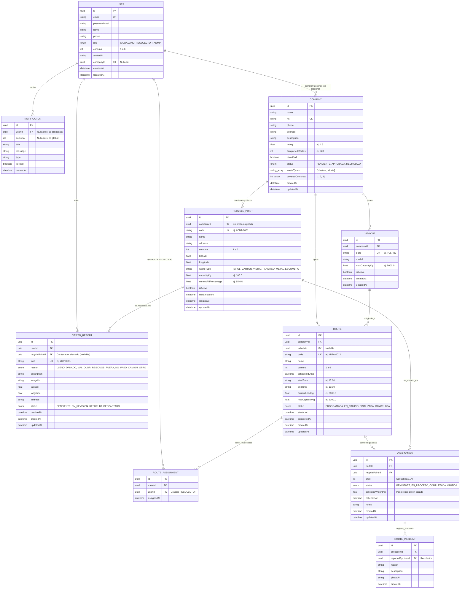

# Modelo de Datos - EcoRuta

El almacenamiento relacional de **EcoRuta** está respaldado por PostgreSQL y gestionado a través de **Prisma ORM**. El diseño satisface los requerimientos visuales y operativos de los dos actores principales: **Ciudadanos** y **Recolectores / Cuadrillas de Aseo**.

---

## 1. Diagrama Entidad-Relación (MER)

---

## 2. Tipos Enumerados (Enums)

### 2.1 `UserRole`
- `CIUDADANO`: Usuario general que consulta horarios, separa residuos y emite reportes.
- `RECOLECTOR`: Operador o conductor de cuadrilla que atiende las paradas en ruta.
- `ADMIN`: Administrador de la plataforma o supervisor municipal de servicios públicos.

### 2.2 `WasteType`
- `PAPEL_CARTON`: Periódicos, revistas, cajas de cartón, hojas de oficina, cuadernos.
- `VIDRIO`: Botellas, frascos limpios.
- `PLASTICO`: Botellas PET, envases plásticos limpios y secos.
- `METAL`: Latas de aluminio, conservas, ganchos y clips.
- `ESCOMBRO`: Residuos de construcción y reformas menores domiciliarias.
- `ORGANICO`: Restos de comida y podas (para rutas orgánicas municipales).

### 2.3 `RouteStatus`
- `PROGRAMADA`: Ruta agendada en calendario previo a su inicio.
- `EN_CAMINO`: Camión en desplazamiento activo transmitiendo telemetría en tiempo real.
- `FINALIZADA`: Todas las paradas completadas y turno cerrado.
- `CANCELADA`: Ruta suspendida por fuerza mayor o mantenimiento vial.

### 2.4 `CollectionStatus`
- `PENDIENTE`: Parada aún no visitada en la secuencia.
- `EN_PROCESO`: Camión estacionado en el punto realizando vaciado.
- `COMPLETADA`: Contenedor vaciado y peso registrado con éxito.
- `OMITIDA`: Parada no recolectada debido a una incidencia reportada.

### 2.5 `CitizenReportReason`
- `CONTENEDOR_LLENO`: Nivel de llenado desbordado (> 90%).
- `DANADO`: Contenedor roto, sin tapa, con fisuras o vandalizado.
- `MAL_OLOR`: Lixiviados o descomposición excesiva en el punto.
- `RESIDUOS_FUERA`: Acumulación de basura en la vía pública alrededor del contenedor.
- `CAMION_NO_PASO`: El vehículo de recolección no cumplió el horario publicado.
- `OTRO`: Otras observaciones del ciudadano.

### 2.6 `CitizenReportStatus`
- `PENDIENTE`: Reporte radicado con folio pendiente de revisión.
- `EN_REVISION`: Empresa de aseo o supervisor municipal analizando la queja.
- `RESUELTO`: Cuadrilla atendió el incidente y vació/reparó el punto.
- `DESCARTADO`: Reporte duplicado o falsa alarma.

### 2.7 `CompanyStatus`
- `PENDIENTE`: Solicitud de registro B2B ingresada por formulario.
- `APROBADA`: Empresa verificada con NIT validado y activa en el directorio.
- `RECHAZADA`: Solicitud descartada por inconsistencia de datos o permisos.

---

## 3. Entidades Detalladas y Restricciones

### 1. `User` (Usuarios del Sistema)
- **id**: `UUID` (PK, `gen_random_uuid()`).
- **email**: `VARCHAR(255)` (Unique, Index).
- **passwordHash**: `VARCHAR(255)` (Argon2id o bcrypt).
- **name**: `VARCHAR(150)`.
- **phone**: `VARCHAR(30)` (Nullable).
- **role**: `UserRole` (Default `CIUDADANO`).
- **comuna**: `SMALLINT` (Nullable, rango 1 a 6 según división político-administrativa de Tuluá).
- **avatarUrl**: `TEXT` (Nullable).
- **companyId**: `UUID` (Nullable, FK -> `Company.id` para usuarios con rol `RECOLECTOR` o delegados corporativos).
- **createdAt**: `TIMESTAMPTZ` (Default `now()`).
- **updatedAt**: `TIMESTAMPTZ` (Auto-updated).

### 2. `Company` (Empresas Recolectoras y Operadoras)
- **id**: `UUID` (PK).
- **name**: `VARCHAR(150)` (ej. *"EcoAseo Tuluá"*).
- **nit**: `VARCHAR(30)` (Unique, ej. *"900.123.456-7"*).
- **phone**: `VARCHAR(30)`.
- **address**: `VARCHAR(255)` (Nullable).
- **description**: `TEXT` (Nullable, ej. *"Aseo urbano y reciclaje"*).
- **rating**: `DECIMAL(3, 2)` (Default `5.00`, rango `0.00` a `5.00`).
- **completedRoutes**: `INTEGER` (Default `0`).
- **isVerified**: `BOOLEAN` (Default `false`).
- **status**: `CompanyStatus` (Default `PENDIENTE`).
- **wasteTypes**: `TEXT[]` (Array de residuos autorizados, ej. `['PAPEL_CARTON', 'VIDRIO', 'PLASTICO']`).
- **coveredComunas**: `INTEGER[]` (Array de comunas que cubre, ej. `[1, 2, 3, 4, 5, 6]`).
- **createdAt**: `TIMESTAMPTZ`.
- **updatedAt**: `TIMESTAMPTZ`.

### 3. `Vehicle` (Flota de Camiones Recolectores)
- **id**: `UUID` (PK).
- **companyId**: `UUID` (FK -> `Company.id`, OnDelete `CASCADE`).
- **plate**: `VARCHAR(15)` (Unique, ej. *"TUL-482"*).
- **model**: `VARCHAR(100)` (Nullable).
- **maxCapacityKg**: `DECIMAL(8, 2)` (Default `5000.00`).
- **isActive**: `BOOLEAN` (Default `true`).
- **createdAt**: `TIMESTAMPTZ`.
- **updatedAt**: `TIMESTAMPTZ`.

### 4. `RecyclePoint` (Puntos de Reciclaje / Contenedores Públicos)
- **id**: `UUID` (PK).
- **companyId**: `UUID` (FK -> `Company.id`, Nullable, empresa que realiza el vaciado).
- **code**: `VARCHAR(20)` (Unique, Index, ej. `"#CNT-0001"`).
- **name**: `VARCHAR(150)`.
- **address**: `VARCHAR(255)`.
- **comuna**: `SMALLINT` (Index, 1 a 6).
- **latitude**: `DECIMAL(10, 8)` (Coordenada GPS WGS84).
- **longitude**: `DECIMAL(11, 8)` (Coordenada GPS WGS84).
- **wasteType**: `WasteType` (Tipo de residuo específico que admite).
- **capacityKg**: `DECIMAL(7, 2)` (Capacidad nominal, ej. `100.00`).
- **currentFillPercentage**: `DECIMAL(5, 2)` (Default `0.00`, 0% a 100%).
- **isActive**: `BOOLEAN` (Default `true`, Index).
- **lastEmptiedAt**: `TIMESTAMPTZ` (Nullable).
- **createdAt**: `TIMESTAMPTZ`.
- **updatedAt**: `TIMESTAMPTZ`.

### 5. `Route` (Rutas de Recolección Programadas y Activas)
- **id**: `UUID` (PK).
- **companyId**: `UUID` (FK -> `Company.id`, OnDelete `RESTRICT`).
- **vehicleId**: `UUID` (Nullable, FK -> `Vehicle.id`, OnDelete `SET NULL`).
- **code**: `VARCHAR(20)` (Unique, Index, ej. `"#RTA-0012"`).
- **name**: `VARCHAR(150)` (ej. *"Ruta Matutina Comuna 1"*).
- **comuna**: `SMALLINT` (Index).
- **scheduledDate**: `DATE` (Fecha asignada de ejecución).
- **startTime**: `VARCHAR(10)` (ej. *"17:00"*).
- **endTime**: `VARCHAR(10)` (ej. *"19:00"*).
- **currentLoadKg**: `DECIMAL(8, 2)` (Default `0.00`, peso cargado en vivo).
- **maxCapacityKg**: `DECIMAL(8, 2)` (Capacidad límite del camión en ruta).
- **status**: `RouteStatus` (Default `PROGRAMADA`, Index).
- **startedAt**: `TIMESTAMPTZ` (Nullable).
- **completedAt**: `TIMESTAMPTZ` (Nullable).
- **createdAt**: `TIMESTAMPTZ`.
- **updatedAt**: `TIMESTAMPTZ`.

### 6. `RouteAssignment` (Asignación de Operarios a Rutas)
- **id**: `UUID` (PK).
- **routeId**: `UUID` (FK -> `Route.id`, OnDelete `CASCADE`).
- **userId**: `UUID` (FK -> `User.id`, OnDelete `CASCADE`, usuario con rol `RECOLECTOR`).
- **assignedAt**: `TIMESTAMPTZ` (Default `now()`).
- *Constraint*: `Unique(routeId, userId)`.

### 7. `Collection` (Paradas en Ruta / Tareas de Vaciado)
- **id**: `UUID` (PK).
- **routeId**: `UUID` (FK -> `Route.id`, OnDelete `CASCADE`).
- **recyclePointId**: `UUID` (FK -> `RecyclePoint.id`, OnDelete `RESTRICT`).
- **order**: `INTEGER` (Secuencia de parada en el itinerario 1..N).
- **status**: `CollectionStatus` (Default `PENDIENTE`, Index).
- **collectedWeightKg**: `DECIMAL(7, 2)` (Nullable, peso real recolectado).
- **collectedAt**: `TIMESTAMPTZ` (Nullable, timestamp del vaciado).
- **notes**: `TEXT` (Nullable).
- **createdAt**: `TIMESTAMPTZ`.
- **updatedAt**: `TIMESTAMPTZ`.
- *Constraint*: `Unique(routeId, recyclePointId)`.

### 8. `CitizenReport` (Reportes Ciudadanos de Incidencias)
- **id**: `UUID` (PK).
- **userId**: `UUID` (FK -> `User.id`, OnDelete `SET NULL`).
- **recyclePointId**: `UUID` (Nullable, FK -> `RecyclePoint.id`, OnDelete `SET NULL`).
- **folio**: `VARCHAR(20)` (Unique, Index, ej. `"#RP-0231"`).
- **reason**: `CitizenReportReason` (Causa estandarizada de la queja).
- **description**: `TEXT`.
- **imageUrl**: `TEXT` (Nullable, URL en bucket S3/local).
- **latitude**: `DECIMAL(10, 8)` (Nullable si se selecciona contenedor).
- **longitude**: `DECIMAL(11, 8)` (Nullable si se selecciona contenedor).
- **address**: `VARCHAR(255)` (Nullable).
- **status**: `CitizenReportStatus` (Default `PENDIENTE`, Index).
- **resolvedAt**: `TIMESTAMPTZ` (Nullable).
- **createdAt**: `TIMESTAMPTZ`.
- **updatedAt**: `TIMESTAMPTZ`.

### 9. `RouteIncident` (Incidencias Operativas de Recolector)
- **id**: `UUID` (PK).
- **collectionId**: `UUID` (FK -> `Collection.id`, OnDelete `CASCADE`).
- **reportedByUserId**: `UUID` (FK -> `User.id`, recolector que reporta).
- **reason**: `VARCHAR(150)` (ej. *"Acceso bloqueado por vehículo"*).
- **description**: `TEXT` (Nullable).
- **photoUrl**: `TEXT` (Nullable).
- **createdAt**: `TIMESTAMPTZ` (Default `now()`).

### 10. `Notification` (Avisos del Sistema y Notificaciones In-App)
- **id**: `UUID` (PK).
- **userId**: `UUID` (Nullable, FK -> `User.id` para alertas dirigidas; `null` si es broadcast general).
- **comuna**: `SMALLINT` (Nullable, para notificaciones zonales).
- **title**: `VARCHAR(150)` (ej. *"El camión está en camino"*).
- **message**: `TEXT` (ej. *"EcoAseo Tuluá llega a tu sector en ~25 min"*).
- **type**: `VARCHAR(50)` (ej. `CAMION_EN_CAMINO`, `CONTENEDOR_LLENO`, `NUEVA_EMPRESA`, `RECORDATORIO`).
- **isRead**: `BOOLEAN` (Default `false`, Index).
- **createdAt**: `TIMESTAMPTZ` (Default `now()`).
